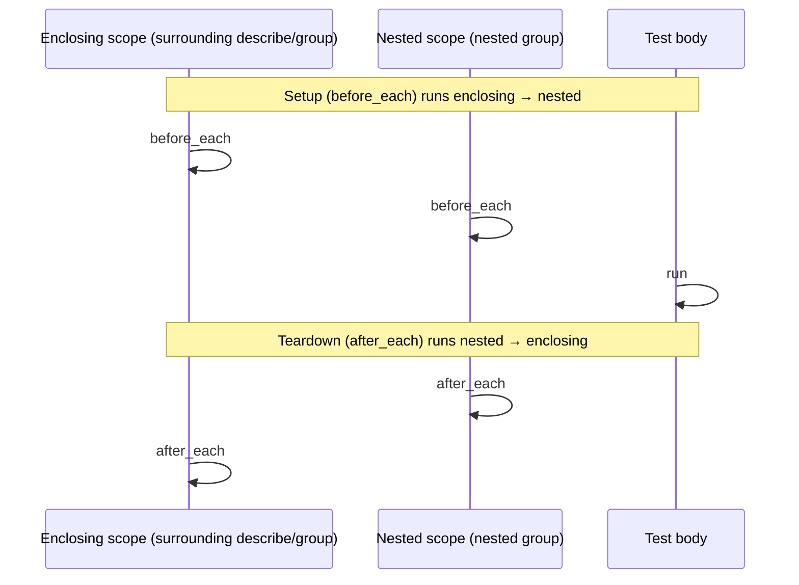

## Lifecycle hooks (`before_all`, `before_each`, `after_each`, `after_all`)

Hooks are a power tool: they remove repetition, but they can also hide the story of a test if you overuse them.

The goal of Dream Test’s hook design is to keep hooks **predictable and debuggable**, especially under parallel execution.

For runner-level hooks (per-test/per-suite/per-run), see [Runner & execution](07-runner-and-execution.md).

### Mental model

Hooks are part of the nested test structure that the runner executes around tests:

- Setup flows **enclosing scope → nested scope**
- Teardown flows **nested scope → enclosing scope**
- If a setup hook fails, Dream Test fails the affected tests **without running the test body**

Hooks let you run setup/teardown logic around tests while keeping the test bodies focused on behavior.

#### Example: hook order (enclosing → nested, then nested → enclosing)

This example prints the execution order so you can see the flow directly:

##### Print the hook order <a href="https://github.com/TrustBound/dream_test/blob/2.2.0/examples/snippets/test/snippets/hooks/hook_order.gleam"></a>

```gleam
import dream_test/matchers.{succeed}
import dream_test/reporters/bdd
import dream_test/reporters/progress
import dream_test/runner
import dream_test/unit.{after_each, before_each, describe, group, it}
import gleam/io

pub fn tests() {
  describe("Enclosing", [
    before_each(fn() {
      io.println("1. enclosing before_each")
      Ok(Nil)
    }),
    after_each(fn() {
      io.println("4. enclosing after_each")
      Ok(Nil)
    }),
    group("Nested", [
      before_each(fn() {
        io.println("2. nested before_each")
        Ok(Nil)
      }),
      after_each(fn() {
        io.println("3. nested after_each")
        Ok(Nil)
      }),
      it("test body runs here", fn() {
        io.println("(test)")
        Ok(succeed())
      }),
    ]),
  ])
}

pub fn main() {
  runner.new([tests()])
  |> runner.progress_reporter(progress.new())
  |> runner.results_reporters([bdd.new()])
  |> runner.exit_on_failure()
  |> runner.run()
}
```

Expected print order:

1. enclosing before_each
2. nested before_each
   (test)
3. nested after_each
4. enclosing after_each

#### Diagram: enclosing scope vs nested scope



#### Example: setup failure skips the test body

If a `before_each` hook returns `Error("...")`, the test body does not run:

##### A failing setup hook <a href="https://github.com/TrustBound/dream_test/blob/2.2.0/examples/snippets/test/snippets/hooks/setup_failure.gleam#L8-L17"></a>

```gleam
pub fn setup_failure_tests() {
  describe("Setup failures", [
    before_each(fn() { Error("could not connect to database") }),
    it("will not run", fn() {
      // This won't execute.
      io.println("nope")
      Ok(succeed())
    }),
  ])
}
```

The runner reports the test as `SetupFailed`.

### When to use hooks

- **Use hooks** for repetitive setup/cleanup (opening DB connections, starting servers, creating temp directories).
- **Avoid hooks** when they hide important context. Prefer explicit setup in the test body for small cases.

Two practical rules of thumb:

- If the setup is essential to understanding the assertion, consider keeping it in the test body.
- If the setup is infrastructure (“start server”, “create temp directory”), hooks usually make things clearer.

### The four hooks

- `before_all`: runs once before any tests in the group
- `before_each`: runs before each test in the group
- `after_each`: runs after each test in the group (even if the test fails)
- `after_all`: runs once after all tests in the group

### Basic lifecycle example

#### All four hooks <a href="https://github.com/TrustBound/dream_test/blob/2.2.0/examples/snippets/test/snippets/hooks/lifecycle_hooks.gleam"></a>

```gleam
import dream_test/matchers.{be_empty, or_fail_with, should}
import dream_test/reporters/bdd
import dream_test/reporters/progress
import dream_test/runner
import dream_test/unit.{
  after_all, after_each, before_all, before_each, describe, it,
}

pub fn tests() {
  describe("Database tests", [
    before_all(fn() {
      // Start database once for all tests
      start_database()
    }),
    before_each(fn() {
      // Begin transaction before each test
      begin_transaction()
    }),
    it("creates a record", fn() {
      []
      |> should
      |> be_empty()
      |> or_fail_with("Placeholder test")
    }),
    it("queries records", fn() {
      []
      |> should
      |> be_empty()
      |> or_fail_with("Placeholder test")
    }),
    after_each(fn() {
      // Rollback transaction after each test
      rollback_transaction()
    }),
    after_all(fn() {
      // Stop database after all tests
      stop_database()
    }),
  ])
}

fn start_database() {
  Ok(Nil)
}

fn stop_database() {
  Ok(Nil)
}

fn begin_transaction() {
  Ok(Nil)
}

fn rollback_transaction() {
  Ok(Nil)
}

pub fn main() {
  runner.new([tests()])
  |> runner.progress_reporter(progress.new())
  |> runner.results_reporters([bdd.new()])
  |> runner.exit_on_failure()
  |> runner.run()
}
```

### Hook inheritance (nested groups)

Nested groups inherit hooks. Setup runs **enclosing → nested**, teardown runs **nested → enclosing**.

#### Inherited hooks <a href="https://github.com/TrustBound/dream_test/blob/2.2.0/examples/snippets/test/snippets/hooks/hook_inheritance.gleam"></a>

```gleam
import dream_test/matchers.{succeed}
import dream_test/reporters/bdd
import dream_test/reporters/progress
import dream_test/runner
import dream_test/unit.{after_each, before_each, describe, group, it}
import gleam/io

pub fn tests() {
  describe("Outer", [
    before_each(fn() {
      io.println("1. outer setup")
      Ok(Nil)
    }),
    after_each(fn() {
      io.println("4. outer teardown")
      Ok(Nil)
    }),
    group("Inner", [
      before_each(fn() {
        io.println("2. inner setup")
        Ok(Nil)
      }),
      after_each(fn() {
        io.println("3. inner teardown")
        Ok(Nil)
      }),
      it("test", fn() {
        io.println("(test)")
        Ok(succeed())
      }),
    ]),
  ])
}

pub fn main() {
  runner.new([tests()])
  |> runner.progress_reporter(progress.new())
  |> runner.results_reporters([bdd.new()])
  |> runner.exit_on_failure()
  |> runner.run()
}
```

### Hook failure behavior (important for reliability)

A hook fails when it returns `Error(message)` or crashes. What happens next depends on the kind of hook:

- **Set-up hook** (`before_all`, `before_each`, `before_each_test`, `before_each_suite`, `before_all_suites`): each test that it serves gets the status `SetupFailed`, and its body does not run. The tear-down hooks of the levels that started still run.
- **Tear-down hook** (`after_each`, `after_each_test`, `after_all`, `after_each_suite`, `after_all_suites`): the statuses of the tests do not change. All the remaining tear-down hooks still run. The run report keeps the failure in its own list (`types.report_teardown_failures`), the reporters show it, and the run fails.

#### Report a setup error <a href="https://github.com/TrustBound/dream_test/blob/2.2.0/examples/snippets/test/snippets/hooks/hook_failure.gleam"></a>

```gleam
import dream_test/matchers.{succeed}
import dream_test/reporters/bdd
import dream_test/reporters/progress
import dream_test/runner
import dream_test/unit.{before_all, describe, it}

fn connect_to_database() {
  Ok(Nil)
}

pub fn tests() {
  describe("Handles failures", [
    before_all(fn() {
      case connect_to_database() {
        Ok(_) -> Ok(Nil)
        Error(e) -> Error("Database connection failed: " <> e)
      }
    }),
    // If before_all fails, these tests are marked SetupFailed (not run)
    it("test1", fn() { Ok(succeed()) }),
    it("test2", fn() { Ok(succeed()) }),
  ])
}

pub fn main() {
  runner.new([tests()])
  |> runner.progress_reporter(progress.new())
  |> runner.results_reporters([bdd.new()])
  |> runner.exit_on_failure()
  |> runner.run()
}
```

#### Report a tear-down error <a href="https://github.com/TrustBound/dream_test/blob/2.2.0/examples/snippets/test/snippets/hooks/teardown_failure.gleam"></a>

```gleam
import dream_test/matchers.{be_equal, or_fail_with, should, succeed}
import dream_test/runner
import dream_test/types.{AfterAllHook, Passed, TeardownFailure}
import dream_test/unit.{after_all, describe, it}
import gleam/list

pub fn cleanup_failure_tests() {
  describe("Database", [
    after_all(fn() { Error("could not drop the test schema") }),
    it("saves a user", fn() { Ok(succeed()) }),
  ])
}

pub fn tests() {
  describe("Tear-down failure example", [
    it("keeps the status of the test", fn() {
      runner.new([cleanup_failure_tests()])
      |> runner.run()
      |> types.report_tests
      |> list.map(fn(result) { result.status })
      |> should
      |> be_equal([Passed])
      |> or_fail_with("expected the test to stay Passed")
    }),
    it("puts the failure in the tear-down list of the report", fn() {
      runner.new([cleanup_failure_tests()])
      |> runner.run()
      |> types.report_teardown_failures
      |> should
      |> be_equal([
        TeardownFailure(
          hook: AfterAllHook,
          scope: ["Database"],
          message: "could not drop the test schema",
        ),
      ])
      |> or_fail_with("expected one tear-down failure")
    }),
  ])
}
```

The BDD and Gherkin reporters show the failure in a `Tear-down failures:` section after the test results. The summary line counts it, for example `1 tear-down failed`. The JSON reporter writes it in `teardown_failures`.

### Where hooks run

A hook can start a resource that its tests use, for example a pool or an ETS table. On the BEAM, such a resource often stops when the process that started it stops. So each scope has one process that runs its hooks and lives as long as the tests that it serves:

| Hooks | Process | Timeout |
|---|---|---|
| `before_all_suites`, `after_all_suites` | one owner process for the whole run | the default timeout, for each hook |
| `before_each_suite`, `after_each_suite` | one owner process for each suite | the default timeout of the suite, for each hook |
| `before_all`, `after_all` | one owner process for each group | the default timeout, for each hook |
| `before_each_test`, `before_each`, the body, `after_each`, `after_each_test` | one process for each test | the default timeout for each hook, the test timeout for the body |

- A pool that `before_all` starts lives until `after_all` stops it. A pool that `before_each` starts lives for the body and the `after_each` hooks of that test.
- The runner waits for each hook with its timeout. A set-up hook that never returns gives `SetupFailed` with `hook timed out in <scope>`. A tear-down hook that never returns is a tear-down failure with the same message. The run goes on.
- A crash in a hook, or a crash of the process that runs it, does not stop the run. The runner records it as a failure of that hook.
- After a timeout or a crash of its owner, the next hook of the scope runs in a new owner process. If the owner of a group stops while the tests run, the run report gets a tear-down failure `before_all process exited in <scope>: <reason>`, and the `after_all` hooks run in a new owner.
- If the body of a test times out, or the test process stops, the `after_each` and `after_each_test` hooks that did not run yet still run, in a new process with their own timeouts. They get the context after the last `before_each` hook that returned. The test keeps its status, for example `TimedOut`.
- When a scope ends, its owner process exits with reason `normal`. An ETS table that the owner made is deleted, and a linked process that traps exits, such as a supervisor, stops.

### Hooks and parallelism (the source of most flaky tests)

Dream Test runs tests in parallel by default (configurable). Hooks don’t change that: they run _around_ tests, but they don’t automatically serialize tests that share resources.

If your hooks touch shared external state (ports, filesystem paths, database schemas), you have two options:

- Make the resource usage isolated (unique temp dirs, unique ports, per-test DB schemas), or
- Run sequentially by setting the runner’s concurrency to 1, or run only the shared-resource suite(s) sequentially using `runner.add_suites_with_config` (see the runner chapter).

### What's Next?

- Go back to [Assertions & matchers](05-assertions-and-matchers.md)
- Go back to [Documentation README](README.md)
- Continue to [Runner & execution model](07-runner-and-execution.md)
